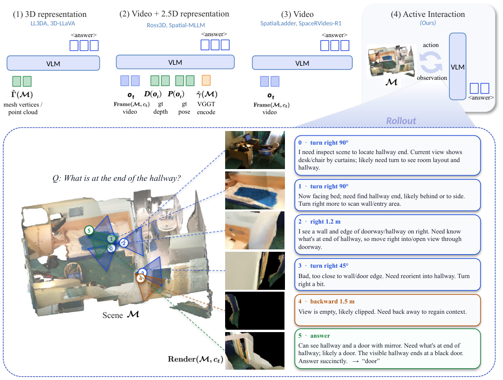

# Act3D: Learning to Think and Explore in 3D World

[Paper](https://arxiv.org/abs/2610.21783) · [Project page](https://williamium3000.github.io/act3d/)

Act3D keeps the 3D scene outside the model. A vision-language model starts from one first-person
view and a question, then alternates between reasoning and acting — moving or turning the camera
and receiving the newly rendered view — until it commits to an answer. Trajectory-supervised
fine-tuning teaches the interaction protocol; reinforcement learning (GRPO) with a reward driven by
answer correctness then optimizes the full policy, without supervising which viewpoints to visit.

<p align="center"></p>

This branch is [verl](https://github.com/volcengine/verl) plus `act3d/` and the small set
of core changes the method needs (Qwen3.5 vision forward, multi-turn tool rollouts that render
token-identically to the SFT data, transformers 5 compatibility).

## Setup

```bash
pip install -r act3d/requirements.txt --extra-index-url https://download.pytorch.org/whl/cu130
pip install -e .
export ACT3D_ROOT=/path/to/act3d_data
```

Tested with Python 3.12 and the versions in `act3d/requirements.txt` (torch 2.13 / CUDA 13,
transformers 5.10, vLLM 0.28); flash-attn is not required.

## Data

The SFT and RL data are on Hugging Face as
[Icey444/Act3D-data](https://huggingface.co/datasets/Icey444/Act3D-data). It holds annotations
only (questions, answers, trajectories, camera poses) and no scene data or images:
- ScanNet, ARKitScenes and Matterport3D do not allow redistribution, so you download their meshes
  yourself under their own terms.
- The Matterport3D questions come from MMScan and are shipped as MMScan ids only.
- `act3d/scripts/build_images.py` renders every image locally with the Act3D renderer and fills in
  the MMScan questions. The SFT trajectories come out pixel-identical to the ones we trained on.

```bash
export ACT3D_ROOT=/path/to/act3d_data
huggingface-cli download Icey444/Act3D-data --repo-type dataset --local-dir $ACT3D_ROOT
# 1. ScanNet and ARKitScenes meshes go under $ACT3D_ROOT/scannet/scans/ and
#    $ACT3D_ROOT/arkitscenes/3dod/Training/ (file list and checksums: annotations/meshes.sha256)
# 2. Matterport3D: crop the per-room meshes from the official house_segmentations
python act3d/scripts/prep_mp3d_regions.py --scans /path/to/matterport/v1/scans --root $ACT3D_ROOT
(cd $ACT3D_ROOT && sha256sum -c annotations/meshes.sha256 --quiet)
# 3. RL validation is the full official ScanQA val split: put ScanQA_v1.0_val.json (see Evaluate)
#    at $ACT3D_ROOT/benchmarks/scanqa/, then render the images and write sft/ and rl/ (CPU only)
PYTHONPATH=act3d python act3d/scripts/build_images.py --mmscan /path/to/LLaVA-3D_MMScan_QA.json --workers 32
```

The dataset README covers each provider's download and terms.

This produces the layout the training scripts read:

```
$ACT3D_ROOT/
├── sft/train.parquet, sft/val.parquet     # trajectories: messages + rendered images (verl multi-turn SFT format)
├── rl/train.parquet, rl/val.parquet       # questions (val = full ScanQA val): start view + extra_info {scene_id, mesh_path, question,
│                                          #   answers, answer_boxes} + reward_model.ground_truth
├── scannet/ arkitscenes/ mp3d/            # meshes; every mesh_path is relative to $ACT3D_ROOT
├── annotations/                           # the downloaded Act3D-data files
├── benchmarks/                            # official evaluation benchmarks (see Evaluate)
└── eval/                                  # evaluation pools built from benchmarks/ by act3d/eval/prepare_eval.py
```

Scene start views and bounds (keyed by `scene_id`) ship in `act3d/act3d/data/`. They cover every
training and evaluation scene.

## Train

The policy is Qwen3.5-9B. The commands below use 4 GPUs (A100-80GB); `GPUS` selects them.

**1. SFT** — 2 epochs, batch 16, lr 1e-5:

```bash
MODEL=/path/to/Qwen3.5-9B GPUS=0,1,2,3 bash act3d/scripts/train_sft.sh
bash act3d/scripts/merge.sh checkpoints/act3d_sft/global_step_600 checkpoints/act3d_sft_hf
```

**2. Answer judge** for the RL reward (Qwen3-30B-A3B-Instruct, OpenAI-compatible on port 30000):

```bash
GPUS=7 bash act3d/scripts/serve_judge.sh
```

**3. RL** — GRPO, 64 prompts x 8 rollouts per step, up to 12 interactions per episode:

```bash
MODEL=checkpoints/act3d_sft_hf GPUS=0,1,2,3 bash act3d/scripts/train_rl.sh
bash act3d/scripts/merge.sh checkpoints/act3d_rl/global_step_100/actor checkpoints/act3d_rl_hf
```

All hyperparameters are in `act3d/configs/act3d_grpo.yaml`; the reward (Eq. 8-9 of the
paper) is `act3d/act3d/reward.py`.

## Evaluate

We do not redistribute any benchmark. Download each one from its official source and put the files
under `$ACT3D_ROOT/benchmarks/`:

| benchmark | official source | put here |
|---|---|---|
| ScanQA v1.0, val (4,675) | [ATR-DBI/ScanQA](https://github.com/ATR-DBI/ScanQA) (dataset link in `docs/dataset.md`) | `benchmarks/scanqa/ScanQA_v1.0_val.json` |
| SQA3D, test (3,519) | [SilongYong/SQA3D](https://github.com/SilongYong/SQA3D) (`sqa_task.zip` on Zenodo, `balanced/` folder) | `benchmarks/sqa3d/v1_balanced_questions_test_scannetv2.json`, `benchmarks/sqa3d/v1_balanced_sqa_annotations_test_scannetv2.json` |
| SPBench MV (319) / SI (1,009) | [hongxingli/SPBench](https://huggingface.co/datasets/hongxingli/SPBench) (SpatialLadder) | `benchmarks/spbench/SPBench-MV.parquet`, `benchmarks/spbench/SPBench-SI.parquet` |
| MP3D (1,000 MMScan questions) | [MMScan](https://github.com/OpenRobotLab/EmbodiedScan) (HF `3dllm/MMScan-beta`) | `benchmarks/mmscan/LLaVA-3D_MMScan_QA.json` |
| ARKit (1,000) | ours: generated from ARKitScenes geometry, in [Act3D-data](https://huggingface.co/datasets/Icey444/Act3D-data) | `annotations/arkit_eval.jsonl` (comes with the Act3D-data download) |

Then build the pools and run:

```bash
python act3d/eval/prepare_eval.py      # writes $ACT3D_ROOT/eval/{scanqa,sqa3d,spbench_mv,spbench_si,mp3d,arkit}.jsonl
python act3d/scripts/prep_mp3d_regions.py --scans /path/to/matterport/v1/scans --pools $ACT3D_ROOT/eval
MODEL=checkpoints/act3d_rl_hf GPUS=0,1,2,3 OUT=out/act3d bash act3d/scripts/eval.sh
```

- **Building the pools:**
  - ScanQA and SPBench are taken whole.
  - SQA3D is taken whole. `act3d/eval/data/sqa3d_situation_index.json` records which of SQA3D's
    situation phrasings each question used in our runs.
  - MP3D is our 1,000-question MMScan subset, listed by MMScan id in
    `act3d/eval/data/mp3d_mmscan_ids.json`.
  - With these, `prepare_eval.py` reproduces the pools behind the paper's numbers question for question.
- **Meshes:** the scenes come from the same official ScanNet, ARKitScenes (`Training` split) and
  Matterport3D downloads as in [Data](#data), under the same `$ACT3D_ROOT` layout. Every pool's
  `mesh_path` is relative to `$ACT3D_ROOT`.
- **What `eval.sh` does:** it serves the checkpoint with vLLM (one server per GPU), runs every
  question interactively, and scores the six benchmarks.

## Citation

```bibtex
@article{li2026act3d,
  title   = {Learning to Think and Explore in 3D World},
  author  = {Li, Yijiang and Wang, Bingyang and Vasconcelos, Nuno},
  journal = {arXiv preprint arXiv:2610.21783},
  year    = {2026}
}
```
